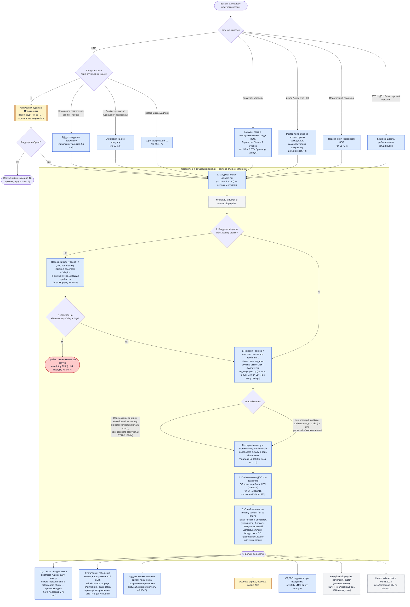
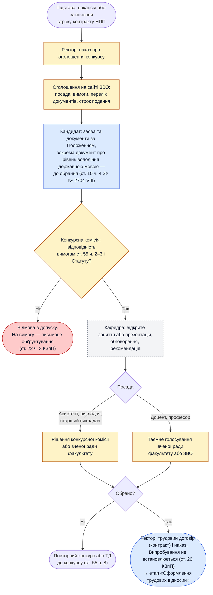
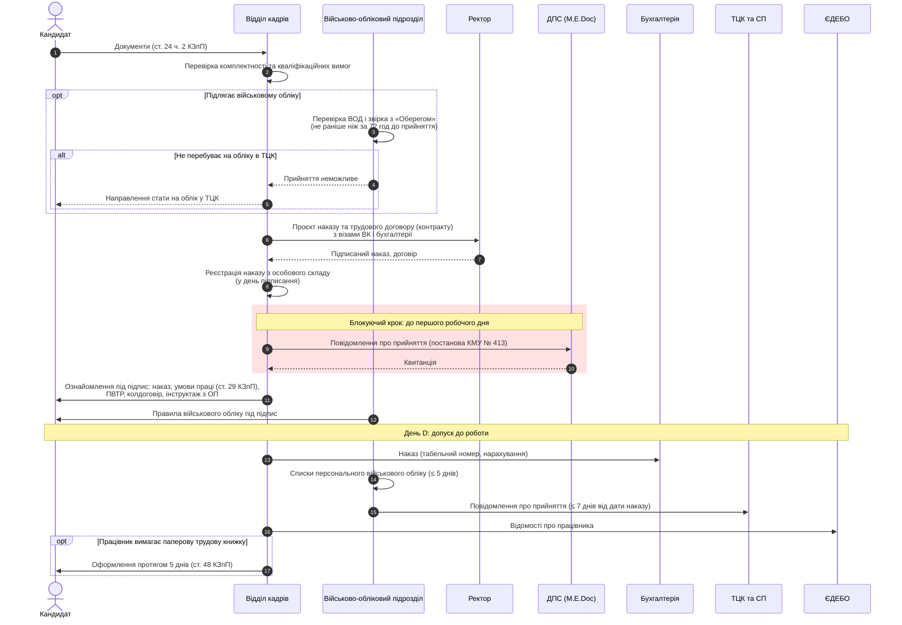

# Прийняття на роботу в закладі вищої освіти: нормативна модель процесу

> **Стан законодавства:** 09.10.2026.
> Це аналітична модель для проєктування процесу в CRM/ISPRO 8, а не юридичний висновок.
> Перед впровадженням позначені місця (⚠️) варто погодити з юридичним відділом.

## 1. Нормативна база

| Акт | Редакція | Що регулює в процесі прийняття |
|---|---|---|
| Кодекс законів про працю України (КЗпП) | 31.07.2026 | Трудовий договір і контракт (ст. 21, 23, 24), заборона вимагати зайві документи (ст. 25), випробування (ст. 26–28), інформування до початку роботи (ст. 29), облік трудової діяльності (ст. 48), медогляди (ст. 169), штрафи (ст. 265) |
| ЗУ «Про вищу освіту» № 1556-VII | 08.10.2026 | Повноваження ректора (ст. 34), завідувач кафедри (ст. 35), декан (ст. 43), посади НПП та конкурсний відбір (ст. 55, в редакції ЗУ № 3791-IX від 06.06.2024), заміщення на час підвищення кваліфікації (ст. 60) |
| ЗУ «Про організацію трудових відносин в умовах воєнного стану» № 2136-IX | чинна | Форма трудового договору, випробування та строкові договори в період воєнного стану (ст. 2) |
| ЗУ «Про забезпечення функціонування української мови як державної» № 2704-VIII | 27.06.2026 | Обов'язок НПП, педагогічних і наукових працівників володіти державною мовою (ст. 9 ч. 1 п. 14), документ на підтвердження (ст. 10 ч. 3–4) |
| Постанова КМУ № 413 від 17.06.2015 | 21.01.2026 | Повідомлення ДПС про прийняття працівника до початку роботи |
| Постанова КМУ № 1487 від 30.12.2022 (Порядок військового обліку) | 27.06.2026 | Перевірка ВОД, повідомлення ТЦК та СП, списки персонального військового обліку (п. 34, 41) |
| Постанова КМУ № 559 від 23.05.2001 | 17.01.2014 | Перелік професій з обов'язковими профілактичними медоглядами |
| Постанова КМУ № 963 від 14.06.2000 | 01.01.2026 | Перелік посад педагогічних і науково-педагогічних працівників |
| ЗУ «Про зайнятість населення» № 5067-VI | 12.09.2025 | Обов'язки роботодавця перед центрами зайнятості (ст. 50) |
| ЗУ «Про захист персональних даних» № 2297-VI | 14.06.2025 | Підстави обробки персональних даних (ст. 11) |
| Наказ Мін'юсту № 1000/5 від 18.06.2015 (Правила організації діловодства) | 04.04.2026 | Візування та реєстрація наказів з кадрових питань |
| Постанова КМУ № 41 від 07.01.2026 | — | Експериментальний проєкт електронного працевлаштування в ЄІАС «Обрій» (через «Дію») |

## 2. Порядок заміщення посад за категоріями

| Категорія | Порядок заміщення | Хто ухвалює рішення | Строк договору | Норма |
|---|---|---|---|---|
| НПП: асистент, викладач, старший викладач, доцент, професор | Конкурсний відбір за порядком, який затверджує вчена рада ЗВО | Визначає Положення про конкурс (зазвичай вчена рада або конкурсна комісія); наказ підписує ректор | Угода сторін або Положення | ст. 55 ч. 7 ЗУ «Про вищу освіту» |
| НПП, виняток 1 | Трудовий договір без конкурсу, якщо штатними працівниками не можна забезпечити освітній процес | Ректор | До проведення конкурсу в поточному навчальному році | ст. 55 ч. 8 |
| НПП, виняток 2 | Заміщення працівника на час підвищення кваліфікації або стажування з відривом від виробництва | Ректор | Строковий трудовий договір (контракт) | ст. 60 ч. 6 |
| НПП, виняток 3 | Іноземні громадяни | Ректор | Короткостроковий трудовий договір | ст. 55 ч. 7 |
| Завідувач кафедри | Конкурс, таємне голосування вченої ради ЗВО з урахуванням пропозицій трудового колективу факультету й кафедри. Потрібні науковий ступінь та/або вчене звання за профілем. Не більше двох строків поспіль | Вчена рада ЗВО; контракт укладає ректор | 5 років | ст. 35 ч. 6 |
| Декан / директор ННІ | Призначення ректором за згодою більшості повного складу органу громадського самоврядування факультету | Ректор | До 5 років, контракт | ст. 43 ч. 1 |
| Педагогічні працівники (структурні коледжі, ліцеї) | Призначення керівником ЗВО | Ректор | За КЗпП | ст. 55 ч. 4 |
| АУП, навчально-допоміжний і обслуговуючий персонал | Вільний вибір роботодавцем серед кандидатів | Ректор | Безстроковий або строковий (ст. 23 КЗпП) | ст. 22 КЗпП, ст. 34 ч. 3 п. 7 ЗУ «Про вищу освіту» |

**Загальні вимоги до НПП:** ступінь магістра та/або науковий (освітньо-творчий) ступінь, та/або вчене звання (ст. 55 ч. 2). Статут ЗВО може встановити додаткові вимоги (ст. 55 ч. 3). Одна особа не може одночасно обіймати дві й більше адміністративно-управлінські посади (ст. 55 ч. 9).

> ⚠️ **Наукові працівники НДЧ** призначаються за окремим ЗУ «Про наукову і науково-технічну діяльність» (ст. 55 ч. 1 ЗУ «Про вищу освіту»). У цій моделі цей порядок детально не розглядається.

## 3. Загальна схема процесу

Кольорами позначено джерело кроку:

- 🟦 **закон / підзаконний акт:** обов'язковий крок, за порушення передбачено санкції;
- 🟨 **локальний акт ЗВО:** Статут, Положення про конкурс, ПВТР;
- ⬜ **внутрішня практика:** не вимагається законом, можна змінювати;
- 🟥 **блокування:** процес зупиняється.

## 4. Конкурсний відбір НПП

Закон передає порядок конкурсу вченій раді ЗВО (ст. 55 ч. 7) і не фіксує ні етапи, ні строки, ні орган, що ухвалює рішення. Нижче наведено типову модель. Конкретні кроки беруться з **Положення про конкурсний відбір** вашого ЗВО.

## 5. Оформлення: учасники та контрольні строки

### Контрольні строки та відповідальність

| Дія | Строк | Норма | Наслідок порушення |
|---|---|---|---|
| Документ про володіння державною мовою (НПП) | До обрання або призначення | ст. 10 ч. 4 ЗУ № 2704-VIII | Особа не може обійняти посаду |
| Перевірка ВОД і звірка з реєстром | Не раніше ніж за 72 год до дати прийняття | п. 34 Порядку № 1487 | Відповідальність за законом (п. 87 Порядку) |
| Прийняття військовозобов'язаного | Лише після взяття на облік у ТЦК | п. 34 Порядку № 1487 | Відповідальність за законом (п. 87 Порядку) |
| Реєстрація наказу з особового складу | У день підписання | Правила № 1000/5, розд. III, гл. 3, п. 2 | — |
| Наказ і повідомлення ДПС | **До початку роботи** | ст. 24 ч. 3 КЗпП, постанова КМУ № 413 | Штраф 10 МЗП за кожного працівника, повторно протягом 2 років — 30 МЗП (ст. 265 ч. 2 КЗпП) |
| Інформування й ознайомлення працівника | До початку роботи | ст. 29 КЗпП | Штраф 1 МЗП за кожне порушення (ст. 265 ч. 2 абз. 10) |
| Внесення до списків персонального військового обліку | 5 днів | п. 41 Порядку № 1487 | Відповідальність за законом |
| Повідомлення ТЦК та СП | 7 днів з дня видання наказу | п. 34 Порядку № 1487 | Відповідальність за законом |
| Оформлення трудової книжки (на вимогу особи, яку приймають уперше) | 5 днів після прийняття | ст. 48 ч. 2 КЗпП | Штраф 1 МЗП (ст. 265 ч. 2 абз. 10) |

## 6. Документи від кандидата

Ст. 25 КЗпП забороняє вимагати документи, подання яких не передбачено законодавством. Тому перелік поділено за підставами.

| Документ | Обов'язковість | Підстава |
|---|---|---|
| Паспорт або інший документ, що посвідчує особу | Так | ст. 24 ч. 2 КЗпП |
| РНОКПП | Так, на практиці | Потрібен для повідомлення ДПС і податкової звітності |
| Трудова книжка **або** відомості з реєстру застрахованих осіб (ОК-5 / ОК-7) | За наявності | ст. 24 ч. 2, ст. 48 КЗпП |
| Документ про освіту, науковий ступінь, вчене звання | Так для НПП. Для інших — якщо цього вимагають кваліфікаційні вимоги посади | ст. 55 ч. 2 ЗУ «Про вищу освіту», ст. 24 ч. 2 КЗпП |
| Рішення про визнання іноземного документа про освіту | Для іноземних дипломів | ст. 36 ч. 2 п. 14 ЗУ «Про вищу освіту» (рішення вченої ради) |
| Військово-обліковий документ (електронний або паперовий) | Для призовників, військовозобов'язаних, резервістів | ст. 24 ч. 2 КЗпП, п. 34 Порядку № 1487 |
| Атестат, що підтверджує вивчення української мови, **або** державний сертифікат | Так для НПП, педагогічних і наукових працівників (крім іноземців, запрошених тимчасово) | ст. 9 ч. 1 п. 14, ст. 10 ч. 3–4 ЗУ № 2704-VIII |
| Медичний висновок | Лише у випадках, передбачених законодавством | ст. 24 ч. 2, ст. 169 КЗпП. ⚠️ НПП ЗВО **не входять** до переліку постанови КМУ № 559: у розд. 6 зазначено «крім вищих навчальних закладів III–IV рівнів акредитації». Огляд потрібен для харчоблоків, шкідливих умов праці, осіб до 21 року |
| Заява про участь у конкурсі | Для НПП | Положення про конкурс (ст. 55 ч. 7) |
| Особовий листок, автобіографія, фото | ⚠️ Законом не передбачено | Ст. 25 КЗпП: не можна ставити умовою прийняття. Допустимо, якщо передбачено Положенням про конкурс |
| Документи на пільги (інвалідність, діти, УБД, ВПО) | Добровільно, щоб отримати пільги чи гарантії | — |
| Згода на обробку персональних даних | Не обов'язкова для даних, які обробляються на підставі договору чи закону | ст. 11 ч. 1 п. 3, 5 ЗУ № 2297-VI |

## 7. Розбіжності з поточним процесом ([npp-hiring.md](npp-hiring.md))

1. **Немає конкурсного відбору.** Для НПП крок «Ректор погоджує кандидатуру» законний лише як виняток за ст. 55 ч. 8 або ст. 60 ч. 6. Основний шлях — конкурс (ст. 55 ч. 7).
2. **Повідомлення ДПС стоїть не там.** Зараз воно йде після проведення наказу, паралельно з розсилкою. За законом це блокуючий крок, який має бути виконано до першого робочого дня. Порушення — найдорожчий ризик процесу: 10 МЗП за кожного працівника.
3. **Немає кроків військового обліку.** Потрібні перевірка ВОД (≤ 72 год), блокування, якщо особа не на обліку, ознайомлення з правилами під підпис, повідомлення ТЦК (7 днів) і списки персонального військового обліку (5 днів). Зараз мобілізаційний відділ лише отримує інформацію.
4. **Центр зайнятості не обов'язковий.** Обов'язок подавати форму 3-ПН скасовано з 02.05.2025 (ЗУ № 4353-IX). Цей крок можна прибрати з обов'язкових.
5. **Перелік документів потребує правок:**
   - додати документ про володіння державною мовою;
   - трудову книжку позначити «за наявності», альтернатива — ОК-5 / ОК-7;
   - медична довідка для НПП не має підстави за постановою КМУ № 559;
   - автобіографію, особовий листок і фото не можна вимагати поза Положенням про конкурс.
6. **Немає етапу ознайомлення за ст. 29 КЗпП** та вступного інструктажу з охорони праці. Обидва мають відбутися до початку роботи.
7. **Відкрите питання «Заносимо наказ у журнал?» — так.** Розпорядчі документи з кадрових питань реєструються окремо, за видами та строками зберігання, у день підписання (Правила № 1000/5, розд. III, гл. 3, п. 2). Проєкт наказу візують працівник кадрової служби, його керівник, бухгалтерія та інші посадові особи, яких він стосується (розд. II, гл. 6, п. 7).
8. **Випробування.** Переможцям конкурсу й обраним на посаду випробування не встановлюється (ст. 26 КЗпП). У період воєнного стану його можна встановити для будь-якої категорії (ст. 2 ч. 2 ЗУ № 2136-IX). Система має перевіряти цю умову.
9. **Контрольний лист із візами підрозділів** — внутрішня практика, законом не вимагається. Його можна замінити електронним погодженням у CRM без правових ризиків.

## 8. Наслідки для CRM / ISPRO 8

Правові «ворота», які варто закласти як правила валідації:

- **Дата початку роботи:** наказ не можна провести, поки немає квитанції ДПС із датою, не пізнішою за дату початку роботи.
- **Військовий облік:** для військовозобов'язаного наказ блокується без відмітки про перевірку ВОД, датованої не раніше ніж за 72 год до прийняття.
- **Випробування:** поле «випробування» недоступне для підстав «переможець конкурсу» або «обраний на посаду», якщо не встановлено ознаку «воєнний стан».
- **Підстава прийняття НПП** — обов'язкове поле зі значеннями: конкурс (з реквізитами протоколу), ст. 55 ч. 8, ст. 60 ч. 6, іноземець. Для ст. 55 ч. 8 строк договору обмежений кінцем поточного навчального року.
- **Нагадування про строки:** списки персонального військового обліку — D+5, ТЦК — D+7 від дати наказу, трудова книжка на вимогу — D+5.
- **Перспектива:** ЄІАС «Обрій» (постанова КМУ № 41 від 07.01.2026, експеримент на 2 роки, участь добровільна). Через «Дію» оформлюють прийняття, а повідомлення до ДПС, ПФУ та ТЦК передаються автоматично через API. Варто врахувати в архітектурі інтеграції.

## 9. Відкриті питання та застереження

- ⚠️ **Строкові договори у воєнний стан і НПП.** Ст. 2 ЗУ № 2136-IX дозволяє строкові договори на період воєнного стану, але не скасовує спеціальної вимоги конкурсу для НПП (ст. 55 ч. 7). Застосування без конкурсу потребує юридичної оцінки.
- ⚠️ **Оцифрування трудових книжок.** П'ятирічний перехідний період (ЗУ № 1217-IX) завершився 10.06.2026. Внесення даних триває на загальних підставах. Законопроєкт № 14257 про продовження строку станом на дату документа не ухвалено.
- ⚠️ **Законопроєкт № 14141** про електронні трудові договори з КЕП (зміни до ст. 24 КЗпП) прийнято лише в першому читанні.
- Ключові норми прив'язані до режиму воєнного стану (випробування, форма договору, строкові договори). Його чинність треба перевіряти на дату кожного прийняття.

## Джерела

- [КЗпП України](https://zakon.rada.gov.ua/laws/show/322-08)
- [ЗУ «Про вищу освіту»](https://zakon.rada.gov.ua/laws/show/1556-18)
- [ЗУ «Про організацію трудових відносин в умовах воєнного стану»](https://zakon.rada.gov.ua/laws/show/2136-20)
- [ЗУ «Про забезпечення функціонування української мови як державної»](https://zakon.rada.gov.ua/laws/show/2704-19)
- [Постанова КМУ № 413](https://zakon.rada.gov.ua/laws/show/413-2015-%D0%BF)
- [Постанова КМУ № 1487 (Порядок військового обліку)](https://zakon.rada.gov.ua/laws/show/1487-2022-%D0%BF)
- [Постанова КМУ № 559](https://zakon.rada.gov.ua/laws/show/559-2001-%D0%BF)
- [Постанова КМУ № 963](https://zakon.rada.gov.ua/laws/show/963-2000-%D0%BF)
- [ЗУ «Про зайнятість населення»](https://zakon.rada.gov.ua/laws/show/5067-17)
- [ЗУ «Про захист персональних даних»](https://zakon.rada.gov.ua/laws/show/2297-17)
- [ЗУ № 1217-IX (облік трудової діяльності в електронній формі)](https://zakon.rada.gov.ua/laws/show/1217-20)
- [Правила організації діловодства, наказ Мін'юсту № 1000/5](https://zakon.rada.gov.ua/laws/show/z0736-15)
- [Скасування обов'язкової форми 3-ПН (ЗУ № 4353-IX)](https://buhplatforma.com.ua/news/68148-robotodavtsi-bilshe-ne-podavatimut-povidomlennya-pro-vakansii-3-pn)
- [Оцифрування трудових книжок після 10.06.2026 (КМУ)](https://www.kmu.gov.ua/news/pislia-10-chervnia-otsyfruvannia-trudovykh-knyzhok-prodovzhytsia-strakhovyi-stazh-ne-znykne)
- [Експериментальний проєкт «Обрій» (КМУ)](https://www.kmu.gov.ua/news/tsyfrovizatsiia-rynku-pratsi-uriad-zapustyv-eksperymentalnyi-proekt-iz-elektronnoho-pratsevlashtuvannia-v-systemi-obrii)
