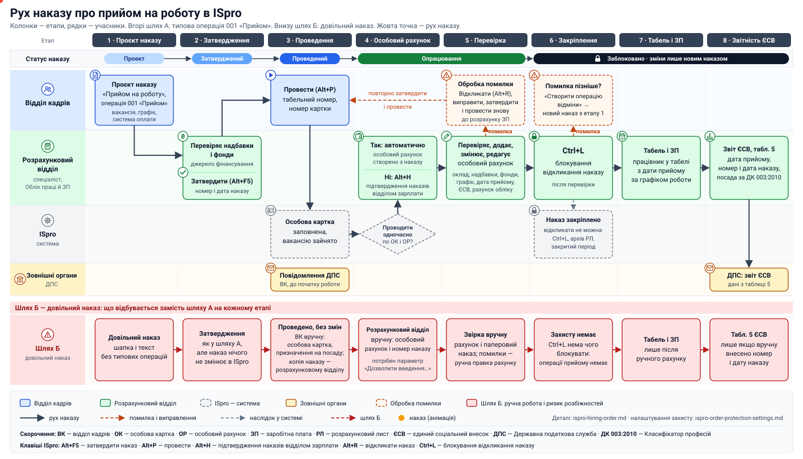
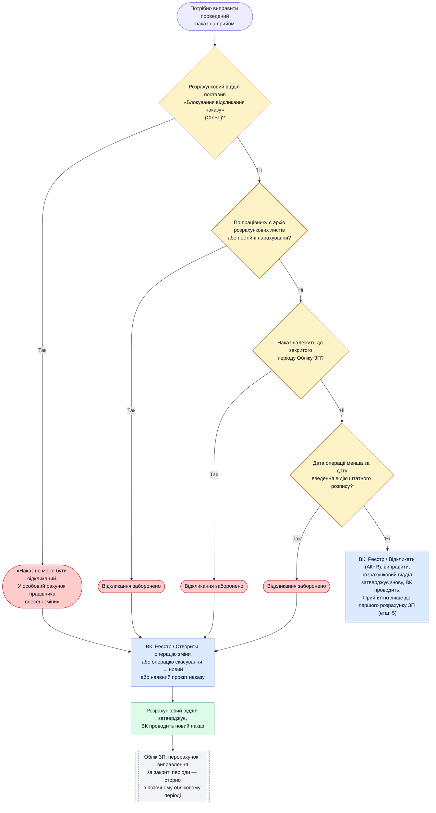

# Прийом на роботу в ISpro: типова операція «Прийом» чи довільний наказ

> **Джерела:** інструкції користувача ISpro 7.11.038 — Розділ 10 «Облік кадрів» і Розділ 11 «Облік праці й заробітної плати», документація doc.ispro.ua.
> Університет працює на **ISPRO 8**: назви параметрів і поведінку позначених місць (⚠️) треба перевірити на інсталяції.
> Правова частина прийому (конкурс, ДПС, військовий облік) — у [hiring-legal-framework.md](hiring-legal-framework.md).

## 1. Терміни

- **Типова операція 001 «Прийом»** — операція наказу з обов'язковими реквізитами. Під час проведення наказу вона змінює особову картку (Облік кадрів), особовий рахунок (Облік праці й заробітної плати) і штатний розпис.
- **Довільний наказ** — наказ групи «Довільні»: «накази, що не відображаються в особових картках». Це шапка й текст без типових операцій. Реєстр показує такий наказ червоним.
- **Особова картка** — картка працівника в підсистемі «Облік кадрів».
- **Особовий рахунок** — картка працівника в підсистемі «Облік праці й заробітної плати», основа для табеля і розрахунку ЗП.

## 2. Альтернативні шляхи роботи кадрів і розрахункового відділу

### Схема руху наказу

[Відкрити схему окремо](img/ispro-order-flow.svg) — у браузері видно анімацію руху наказу.

Рух наказу між журналами відділів (К1-1, К1-2, П-1, Р-1, К2) — [order-journals-flow.svg](img/order-journals-flow.svg), оцифрована рукописна схема.

Наказ затверджує спеціаліст розрахункового відділу, а перевірка особового рахунку з обробкою помилок — окремий етап перед блокуванням. Усього 8 етапів; нумерація однакова на схемі, у детальній схемі нижче і в таблиці розділу 3.

### Детальна схема

Кольорами позначено виконавця кроку:

- 🟦 **Відділ кадрів (ВК);**
- 🟩 **Розрахунковий відділ** — спеціаліст, підсистема «Облік праці й заробітної плати»;
- ⬜ **система ISpro** — виконує автоматично; сірий ромб — параметр налаштування, від якого залежить маршрут;
- 🟨 **зовнішні органи** (ДПС);
- 🟧 **обробка помилки;**
- 🟥 **ручна робота без зв'язку з наказом** — ризик розбіжностей.

Номер на початку кроку — етап.

```mermaid
flowchart TB
    START(["Кандидата погоджено, документи перевірено<br/>(див. hiring-legal-framework.md)"]) --> WAY{"Як оформлено<br/>наказ про прийом?"}

    WAY -- "Шлях А: типова операція 001 «Прийом»" --> A1
    WAY -- "Шлях Б: довільний наказ" --> B1

    subgraph PATH_A ["Шлях А — типова операція 001 «Прийом»"]
        direction TB
        A1["1 · ВК · Накази: проєкт наказу виду «Прийом на роботу»,<br/>операція 001 «Прийом» (Shift+Insert)"]
        A1 --> A2["1 · ВК: «Вибір вакансії» — підрозділ, посада, категорія,<br/>оклад і ставки підтягуються зі штатного розпису.<br/>Вручну: обліковий склад, дата прийому,<br/>підстава прийому, спосіб призначення"]
        A2 --> A3["1 · ВК · кнопка «Особова картка»: графік роботи<br/>і система оплати (обов'язково), стать,<br/>дата народження, РНОКПП, громадянство"]
        A3 --> A4["2 · Розрахунковий відділ: перевіряє надбавки<br/>і фонди (джерело фінансування)"]
        A4 --> A5["2 · Розрахунковий відділ: Реєстр / Затвердити (Alt+F5),<br/>номер і дата наказу"]
        A5 --> A6["3 · ВК: Реєстр / Провести (Alt+P).<br/>«Призначення номерів працівникам»:<br/>табельний номер, номер картки"]
        A6 -.-> A_DPS["3 · ВК → ДПС: повідомлення про прийняття<br/>до початку роботи (поза ISpro)"]
        A6 --> A_SYS[["3 · Система: особову картку заповнено,<br/>вакансію в штатному розписі зайнято"]]
        A_SYS --> A_CFG{"4 · Параметр «Проводити накази<br/>одночасно по Особових картках<br/>і Особових рахунках»"}
        A_CFG -- "Так" --> A_OR
        A_CFG -- "Ні або «Виконання наказів<br/>Розрахунковим відділом Зарплати»" --> A_RV1["4 · Розрахунковий відділ: Реєстр / Підтвердження<br/>наказів відділом зарплати (Alt+H)"]
        A_RV1 --> A_OR[["4 · Система: особовий рахунок створено з наказу<br/>з датою вступу в силу; наказ видно<br/>на закладці «Призначення та переміщення»"]]
        A_OR --> A_CHECK["5 · Розрахунковий відділ перевіряє, додає, змінює,<br/>редагує особовий рахунок: оклад, надбавки, фонди,<br/>графік, дата прийому; додає вид ЄСВ, рахунок обліку,<br/>код бюджетної класифікації, постійні утримання"]
        A_CHECK --> A_ERR{"5 · Помилка<br/>в даних наказу?"}
        A_ERR -- "Так, до розрахунку ЗП" --> A_FIX["5 · ВК: Реєстр / Відкликати (Alt+R),<br/>виправити наказ"]
        A_FIX -- "повторно затвердити<br/>і провести" --> A5
        A_ERR -- "Ні" --> A_LOCK["6 · Розрахунковий відділ: Реєстр / Блокування<br/>відкликання наказу (Ctrl+L)"]
        A_LOCK -. "помилка після блокування" .-> A_LATE["6 · ВК: «Створити операцію відміни» →<br/>новий наказ з етапу 1"]
    end

    subgraph PATH_B ["Шлях Б — довільний наказ"]
        direction TB
        B1["1 · ВК · Накази: вид «Довільний» —<br/>шапка і текст без типових операцій"]
        B1 --> B2["2 · Розрахунковий відділ: затверджує (Alt+F5),<br/>але наказ без операцій нічого не змінює в ISpro"]
        B2 --> B3["3 · ВК: Провести (Alt+P)"]
        B3 --> B_SYS[["3 · Система: особова картка, особовий рахунок<br/>і штатний розпис не змінюються"]]
        B_SYS --> B4["3 · ВК вручну: особова картка в модулі<br/>«Особові картки працівників»,<br/>Штатний розпис / Призначити на посаду"]
        B4 --> B5["3 · ВК → Розрахунковий відділ: копія наказу<br/>поза системою (папір, скан, e-mail)"]
        B5 --> B_CFG{"Параметр Обліку кадрів<br/>«Дозволити введення працівників<br/>у підсистемі Облік зарплати»"}
        B_CFG -- "Вимкнено" --> B_STOP(["Розрахунковий відділ не може<br/>створити особовий рахунок"])
        B_CFG -- "Увімкнено" --> B6["4 · Розрахунковий відділ вручну: особовий рахунок (Insert) —<br/>ПІБ, підрозділ, посада, обліковий склад, графік,<br/>система оплати, оклад, ставки, дата прийому,<br/>РНОКПП, вид ЄСВ, рахунок обліку, джерело фінансування"]
        B6 --> B7["4 · Розрахунковий відділ вручну: номер і дата наказу<br/>(без них таблиця 5 ЄСВ не заповниться)"]
        B7 --> B8["5 · Розрахунковий відділ: звірка рахунку з паперовим<br/>наказом; помилки — ручна правка рахунку"]
        B8 --> B_RISK[["6 · Захист від відкату не діє: в обліку кадрів<br/>немає операції прийому, яку можна заблокувати"]]
    end

    A_LOCK --> TAB
    B_RISK --> TAB
    TAB[["7 · Табель: працівник з дати прийому<br/>за графіком роботи"]] --> CALC["7 · Розрахунковий відділ: розрахунок ЗП"]
    CALC --> ESV["8 · Розрахунковий відділ: звіт ЄСВ, таблиця 5 —<br/>дата прийому, номер і дата наказу,<br/>посада за ДК 003:2010"]
    ESV --> ESV_DPS["8 · ДПС: звіт ЄСВ"]

    classDef hr fill:#dbeafe,stroke:#1d4ed8,color:#0f172a
    classDef buh fill:#dcfce7,stroke:#15803d,color:#0f172a
    classDef sys fill:#f3f4f6,stroke:#6b7280,stroke-dasharray:4 3,color:#0f172a
    classDef ext fill:#fef3c7,stroke:#b45309,color:#0f172a
    classDef err fill:#fff7ed,stroke:#c2410c,stroke-dasharray:4 3,color:#0f172a
    classDef risk fill:#fecaca,stroke:#b91c1c,color:#0f172a

    class A1,A2,A3,A6,B1,B3 hr
    class A4,A5,A_RV1,A_CHECK,A_ERR,A_LOCK,B2,CALC,ESV buh
    class A_SYS,A_OR,A_CFG,B_SYS,B_CFG,TAB sys
    class A_DPS,ESV_DPS ext
    class A_FIX,A_LATE err
    class B4,B5,B6,B7,B8,B_RISK,B_STOP risk
```

## 3. Хто що робить на якому етапі

| Етап | Шлях А: ВК | Шлях А: Розрахунковий відділ | Шлях Б: ВК | Шлях Б: Розрахунковий відділ |
|---|---|---|---|---|
| **0. Налаштування** (одноразово) | Вакансія в чинному штатному розписі, підписанти на штатних позиціях | Права на затвердження наказів у модулі «Накази» Обліку кадрів (⚠️ розділ 6) | — | Потрібен параметр «Дозволити введення працівників у підсистемі Облік зарплати» |
| **1. Проєкт наказу** | Наказ «Прийом на роботу» з операцією 001; вакансія, реквізити операції, графік і система оплати в особовій картці | — | Довільний наказ: шапка й текст | — |
| **2. Затвердження** | — | Перевіряє надбавки й фонди (джерело фінансування), затверджує (Alt+F5): номер і дата наказу | — | Те саме, але наказ без операцій нічого не змінює в ISpro |
| **3. Проведення** | Провести (Alt+P), табельний номер і номер картки. До початку роботи — повідомлення ДПС (поза ISpro) | — | Провести; **вручну** особова картка й призначення на посаду в штатному розписі; копія наказу в розрахунковий відділ | — |
| **4. Особовий рахунок** | — | Створюється з наказу: автоматично або після підтвердження (Alt+H) — залежить від параметра «Проводити накази одночасно по ОК і ОР» | — | **Вручну** весь особовий рахунок і номер/дата наказу |
| **5. Перевірка** | Якщо розрахунковий відділ знайшов помилку в даних наказу: Відкликати (Alt+R), виправити; після повторного затвердження провести знову. Лише до розрахунку ЗП | Перевіряє, додає, змінює, редагує особовий рахунок: оклад, надбавки, фонди, графік, дата прийому; додає вид ЄСВ, рахунок обліку. Помилку в даних наказу повертає у ВК | — | Звірка рахунку з паперовим наказом; помилки — ручна правка рахунку без зв'язку з наказом |
| **6. Закріплення** | Помилка після блокування — «Створити операцію відміни», новий наказ з етапу 1 | Блокування відкликання наказу (Ctrl+L), розділ 4 | — | Захисту немає |
| **7. Табель і розрахунок** | — | Працівник у табелі з дати прийому; розрахунок ЗП | — | Те саме, але лише після ручного створення особового рахунку |
| **8. Звітність ЄСВ** | — | Таблиця 5 заповнюється з наказу; звіт подається в ДПС | — | Таблиця 5 заповнюється, лише якщо номер і дату наказу внесено вручну |

### Що отримує розрахунковий модуль

| | Шлях А: операція 001 | Шлях Б: довільний наказ |
|---|---|---|
| **Особовий рахунок** | Створюється і заповнюється з наказу з датою вступу в силу | Не створюється; розрахунковий відділ вводить усі дані вдруге |
| **Табель** | Працівник потрапляє в табель за графіком з дати прийому | Лише після ручного створення особового рахунку |
| **Перерахунки** | Поля, що впливають на ЗП, змінюються наказами з датою вступу в силу; при змінах заднім числом — коригувальні записи | Зв'язку з наказом немає; правка на одному боці не потрапляє на інший |
| **ЄСВ, таблиця 5** | Дата, номер наказу, посада — з наказу | Лише з того, що розрахунковий відділ ввів вручну |
| **Штатний розпис** | Вакансію зайнято, діє контроль перевитрати ставок | Вакансія вільна, поки ВК не призначить працівника вручну |
| **Захист від відкату** | Діє (розділ 4) | Не діє |

Навіть якщо в Обліку ЗП вимкнено параметр «Передавати дані наказів в Табель, Документи і Розрахункові листи», з наказів передаються операції призначення, переміщення і звільнення. Тобто ISpro розраховує, що прийом оформлюється типовою операцією.

## 4. Захист від відкату

Де вмикається кожен механізм і де він описаний у документації ISpro — у довіднику [ispro-order-protection-settings.md](ispro-order-protection-settings.md).

### 4.1. Навіщо

Після проведення наказу на прийом розрахунковий відділ будує на ньому розрахункові листи, постійні нарахування і звітність ЄСВ. Якщо ВК відкличе такий наказ, особовий рахунок зміниться заднім числом. Наслідки:

- перерахунок ЗП і коригувальні записи за минулі періоди;
- розбіжність з уже поданим звітом ЄСВ і повідомленням ДПС;
- у закритому періоді — розбіжність з Головною книгою і Обліком грошових коштів.

Тому наказ на прийом спершу перевіряють (етап 5): поки немає розрахунку ЗП, помилку виправляють відкликанням. Після перевірки наказ закріплюють (етап 6), і далі помилки виправляють лише **новим наказом**.

### 4.2. Що відбувається при спробі виправити проведений наказ

Порядок перевірок на схемі умовний: спрацьовує будь-яке ввімкнене блокування.

### 4.3. Блокування відкликання

| Механізм | Де налаштовується | Що блокує | Хто керує | Рекомендація |
|---|---|---|---|---|
| «Заборона відкликання наказів на прийом при наявності архівів РЛ або постійних нарахувань» | Облік кадрів / Налаштування / Параметри / Накази | Відкликання наказу на прийом, якщо по працівнику вже є архів розрахункових листів або постійні нарахування | Адміністратор | Увімкнути |
| «Заборона скасування (відкликання) наказів у закритому періоді» | Там само | Відкликання і скасування наказів у закритих періодах Обліку ЗП | Адміністратор | Увімкнути |
| «Заборона на відкликання наказів, що містять операції з датою меншою, ніж дата введення в дію штатного розкладу» | Там само | Відкликання наказів, які змінюють історію до чинного штатного розпису | Адміністратор | Увімкнути |
| «Блокування відкликання наказу» (Ctrl+L) | Облік ЗП / Особові рахунки / Реєстр | Відкликання наказу на прийом конкретного працівника; можна ставити групою | Розрахунковий відділ | Ставити після перевірки особового рахунку (етап 5), на етапі 6 |
| «Заборона використання спеціальних функцій у модулі Накази/Розпорядження» | Облік кадрів / Керування доступом / Параметри | Спецфункції (Ctrl+Shift+S) «Дозволити відкликання наказу з помилкою» і «Фізично видалити логічно видалені накази», тобто обхід блокувань вище | Адміністратор | Увімкнути для всіх, крім адміністратора |
| Універсальні документи за наказом | Облік ЗП / Універсальний документ | Наказ не відкликається, поки не видалено всі його універсальні документи | — | Природний бар'єр для відпусток, звільнень, премій; на прийом не впливає |

### 4.4. Захист даних, які змінює наказ

| Механізм | Де налаштовується | Що робить | Рекомендація |
|---|---|---|---|
| «Заборона коригування реквізитів Особових карток, змінюваних наказами» | Облік кадрів / Управління доступом / Параметри (для кожного користувача) | Поля, які змінює наказ, у картці доступні лише для перегляду (F3/F4) | Увімкнути для всіх, крім адміністратора |
| «Заборона коригування в закритих облікових періодах (архів)» | Облік ЗП / Керування доступом / Розрахункові листи | Забороняє вводити й коригувати дані в архіві розрахункових листів | Увімкнути; виправлення — сторно в поточному періоді |
| Запит при ручній правці особового рахунку | Облік ЗП / Особові рахунки | Якщо дані внесено наказом, система питає: змінити останній наказ чи створити новий | Обирати «новий наказ» |

### 4.5. Захист на етапі затвердження

Ці параметри не дають провести помилковий наказ, який потім доведеться відкликати. Усі вони — в Облік кадрів / Управління доступом / Параметри:

| Параметр | Рекомендація |
|---|---|
| «Заборона на затвердження наказів, що призводять до перевитрати вакансій» | Увімкнути |
| «Заборона на затвердження наказів з окладами, що перевищують оклад штатної позиції» | Увімкнути |
| «Дозволяється затвердження наказів з датою введення в дію менше поточної» | Вимкнути; дозволити лише відповідальній особі ВК |
| «Заборона на проведення наказів з датою більшою, ніж максимальна дата закриття зміни до штатного розкладу» | Увімкнути |

### 4.6. Аудит

- **Сервіс / Протокол змін** (Alt+F10) і **Сервіс / Протокол змін запису** (Shift+F10) — історія змін у реєстрі та в конкретному записі, в обох підсистемах.
- Додавання й видалення вкладень у проведених наказах теж протоколюється.

У шляху Б жоден із механізмів 4.3 не працює: довільний наказ нічого не змінює, а особовий рахунок не пов'язаний з кадровим наказом. Залишаються тільки права доступу і протокол змін.

## 5. Наслідки для CRM / ISPRO 8

- **Тип наказу.** Інтеграція CRM → ISpro створює наказ із типовою операцією 001 «Прийом» (повторний прийом — 044), а не довільний наказ. Довільні накази підходять лише для наказів, які не змінюють даних працівника (оголошення конкурсу, склад комісії).
- **Обов'язкові дані від CRM:** ПІБ, штатна позиція (вакансія), обліковий склад, дата прийому, підстава прийому, спосіб призначення, графік роботи, система оплати. Значення «Підстава прийому» варто узгодити з підставами з [hiring-legal-framework.md](hiring-legal-framework.md), розділ 8: конкурс, ст. 55 ч. 8, ст. 60 ч. 6, іноземець.
- **Статус.** CRM має читати статус наказу і ознаку блокування відкликання. Після блокування CRM не ініціює відкликання: виправлення йдуть лише операцією зміни або скасування.
- **Налаштування.** Перелік параметрів із розділу 4 — вимога до адміністратора ISpro перед запуском інтеграції.

## 6. Відкриті питання

- ⚠️ **ISPRO 8.** Схеми побудовано за інструкціями 7.11.038. Параметри захисту і підтвердження наказів (Alt+H) є й у поточній документації doc.ispro.ua (збірка від 12.10.2026), але їхню поведінку треба перевірити на версії університету.
- ⚠️ **Затвердження розрахунковим відділом.** Спеціаліст розрахункового відділу затверджує наказ у модулі «Накази» Обліку кадрів. Для цього йому потрібен доступ до журналу наказів (Керування доступом / Журнали) і право затверджувати без права проводити. Чи можна в ISpro розділити «Затвердити» і «Провести» між користувачами, треба перевірити на інсталяції.
- ⚠️ **Шлях Б.** Чи бачать «Облік кадрів» і «Облік ЗП» одну й ту саму картку, якщо ВК і розрахунковий відділ створюють її вручну окремо, — у документації не описано.
- ⚠️ **Табельний номер.** У [npp-hiring.md](npp-hiring.md) зазначено, що табельний номер видає бухгалтерія. У шляху А ISpro за замовчуванням призначає його у ВК під час проведення. Варіанти: параметр «Присвоєння номерів особових карток і табельних номерів вручну» або діапазони табельних номерів у правах доступу.
- ⚠️ **Поточні налаштування університету.** Які з параметрів розділу 4 уже ввімкнено — уточнити в адміністратора ISpro.

## Джерела

- Поточна документація ISpro: [«Облік кадрів» (PDF)](https://doc.ispro.ua/ua/pdf/kdr.pdf), [«Облік праці й заробітної плати» (PDF)](https://doc.ispro.ua/ua/pdf/pay.pdf), посилання на окремі сторінки — у [ispro-order-protection-settings.md](ispro-order-protection-settings.md)
- [Інструкція користувача ISpro, Розділ 10 «Облік кадрів», в. 7.11.038](https://ispro.ua/uploads/usermanuals/October2020/Pym9IoYv51R6pSdpn5RS.pdf) — параметри наказів (с. 6–7), управління доступом (с. 33–34), реєстр наказів і група «Довільні» (с. 89–98)
- [Інструкція користувача ISpro, Розділ 11 «Облік праці й заробітної плати», в. 7.11.038](https://ispro.ua/uploads/usermanuals/February2022/ni4DSZZoRTsAHuBQ46qf.pdf) — зв'язок з іншими підсистемами (с. 141), керування доступом (с. 156), особові рахунки і блокування відкликання, звіт ЄСВ (с. 305)
- [Накази — doc.ispro.ua](https://doc.ispro.ua/ua/kdr/484.html)
- [Створення наказу на прийняття працівника — doc.ispro.ua](https://doc.ispro.ua/ru/note/per0508.html)
- [Прийом працівника на роботу: алгоритм дій в ISpro — Intelserv](https://intelserv.net.ua/blog/material/id/95)
- [Оформлення нового працівника в ISpro — Intelserv](https://intelserv.net.ua/blog/material/id/29)
