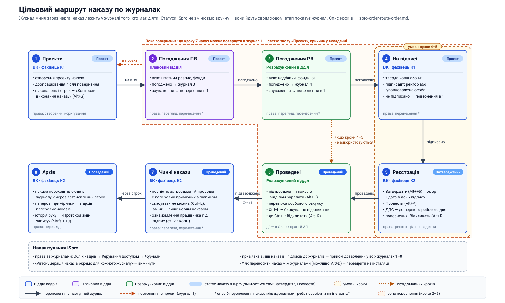

# Проєкт наказу: Порядок руху наказів з особового складу в ISpro

> **Статус:** проєкт для погодження. Поля у квадратних дужках `[…]` заповнює відділ кадрів перед підписанням.
> **Схема маршруту:** [order-journals-target.svg](img/order-journals-target.svg) — додаток до Порядку.
> Примітки до проєкту (що перевірити й узгодити) — в кінці документа, до тексту наказу не входять.

---

**[НАЙМЕНУВАННЯ ЗАКЛАДУ ВИЩОЇ ОСВІТИ]**

**НАКАЗ**

`[дата]`  м. `[місто]`  № `[___]`

**Про затвердження Порядку руху наказів з особового складу в системі ISpro**

З метою впорядкування підготовки, погодження, підписання, реєстрації та проведення наказів з особового складу в системі ISpro, розмежування відповідальності між структурними підрозділами та запобігання розбіжностям між кадровими й розрахунковими даними, відповідно до Правил організації діловодства та архівного зберігання документів у державних органах, органах місцевого самоврядування, на підприємствах, в установах і організаціях, затверджених наказом Міністерства юстиції України від 18.06.2015 № 1000/5, та Інструкції з діловодства `[найменування ЗВО]`

**НАКАЗУЮ:**

1. Затвердити Порядок руху наказів з особового складу в системі ISpro (далі — Порядок), що додається.
2. Начальнику відділу кадрів `[ПІБ]` спільно з адміністратором системи ISpro `[ПІБ]` до `[дата]`:
   1. створити в підсистемі «Облік кадрів» журнали наказів 1–7 відповідно до розділу 3 Порядку;
   2. налаштувати права користувачів на журнали та параметри системи відповідно до розділу 6 Порядку;
   3. провести перевірку маршруту на тестовому наказі та за її результатами подати пропозиції щодо уточнення Порядку.
3. Визначити відповідальних за кроки маршруту:
   - фахівець К1 відділу кадрів — `[посада, ПІБ]`;
   - фахівець К2 відділу кадрів — `[посада, ПІБ]`;
   - від планового відділу — `[посада, ПІБ]`;
   - від розрахункового відділу — `[посада, ПІБ]`.
4. Встановити строк перенесення наказів із журналу 6 «Чинні накази» до журналу 7 «Архів» — `[___]` з дати `[введення наказу в дію / проведення наказу]`.
5. Порядок застосовувати до наказів з особового складу, проєкти яких створено після `[дата]`.
6. Начальникам відділу кадрів, планового та розрахункового відділів ознайомити працівників, задіяних у маршруті, з цим наказом під підпис до `[дата]`.
7. Контроль за виконанням наказу покласти на `[посада, ПІБ]`.

Ректор  `[підпис]`  `[ПІБ]`

Проєкт вносить: начальник відділу кадрів `[ПІБ]`

Погоджено: головний бухгалтер `[ПІБ]`; начальник планового відділу `[ПІБ]`; начальник розрахункового відділу `[ПІБ]`; юрисконсульт `[ПІБ]`

---

**ЗАТВЕРДЖЕНО**
наказом `[найменування ЗВО]`
від `[дата]` № `[___]`

# Порядок руху наказів з особового складу в системі ISpro

## 1. Загальні положення

1.1. Порядок визначає маршрут наказу з особового складу в системі ISpro від створення проєкту до архіву, виконавців на кожному кроці, правила повернення наказу на доопрацювання та необхідні налаштування системи.

1.2. Терміни:

- **Журнал** — категорія наказів у модулі «Накази» підсистеми «Облік кадрів». Журнал показує, чия зараз черга діяти з наказом.
- **Статус наказу в ISpro** — «Проект», «Затверджений», «Проведений». Статус змінюється лише діями системи «Затвердити», «Провести» і «Відкликати» та вручну не встановлюється.
- **Перенесення** — переведення наказу в інший журнал (п. 6.4).
- **Повернення** — перенесення наказу в журнал 1 для доопрацювання (розділ 5).

1.3. Наказ одночасно перебуває лише в одному журналі. Перебування наказу в журналі означає, що дія за наказом очікується від відповідального за цей журнал.

1.4. Схема маршруту є додатком до Порядку.

## 2. Учасники

| Учасник | Роль у маршруті |
|---|---|
| Фахівець К1 відділу кадрів | Готує й доопрацьовує проєкт наказу, організовує підписання, реєструє і проводить наказ |
| Плановий відділ | Погоджує проєкт щодо штатного розпису та фондів |
| Розрахунковий відділ | Погоджує надбавки, фонди та умови оплати; підтверджує проведені накази; встановлює блокування відкликання |
| Підписант — ректор або уповноважена особа | Підписує наказ |
| Фахівець К2 відділу кадрів | Веде журнали «Чинні накази» та «Архів», забезпечує ознайомлення працівника з наказом |

## 3. Журнали наказів

| № | Журнал | Відповідальний | Статус ISpro | Призначення |
|---|---|---|---|---|
| 1 | Проєкти | Фахівець К1 | Проект | Створення і доопрацювання проєктів |
| 2 | Погодження ПВ | Плановий відділ | Проект | Віза планового відділу |
| 3 | Погодження РВ | Розрахунковий відділ | Проект | Віза розрахункового відділу |
| 4 | Підписання і реєстрація | Фахівець К1 | Проект → Затверджений → Проведений | Підписання, присвоєння номера й дати, проведення |
| 5 | Проведені | Розрахунковий відділ | Проведений | Підтвердження у зарплаті та блокування відкликання |
| 6 | Чинні накази | Фахівець К2 | Проведений | Повністю затверджені накази з паперовим примірником, які не можна скасувати |
| 7 | Архів | Фахівець К2 | Проведений | Накази, перенесені з журналу 6 через встановлений строк |

## 4. Порядок руху наказу

### 4.1. Крок 1 — журнал «Проєкти» (фахівець К1, статус «Проект»)

1. Створює проєкт наказу з відповідною типовою операцією (для прийому на роботу — 001 «Прийом») і заповнює обов'язкові реквізити.
2. У «Контролі виконання наказу» (Alt+S) вказує виконавця і строк.
3. Доопрацьовує накази, повернені з кроків 2–5.
4. Переносить наказ у журнал 2.

### 4.2. Крок 2 — журнал «Погодження ПВ» (плановий відділ, статус «Проект»)

1. Перевіряє відповідність наказу штатному розпису та наявність фондів.
2. Якщо зауважень немає — переносить наказ у журнал 3.
3. Якщо є зауваження — повертає наказ у журнал 1, причину додає у вкладення до наказу.

### 4.3. Крок 3 — журнал «Погодження РВ» (розрахунковий відділ, статус «Проект»)

1. Перевіряє надбавки, фонди (джерело фінансування) та умови оплати праці.
2. Якщо зауважень немає — переносить наказ у журнал 4.
3. Якщо є зауваження — повертає наказ у журнал 1, причину додає у вкладення.

### 4.4. Крок 4 — журнал «Підписання і реєстрація» (фахівець К1)

1. Готує паперовий примірник наказу або документ для підписання кваліфікованим електронним підписом.
2. Передає наказ на підпис ректору або уповноваженій особі. Непідписаний наказ повертає в журнал 1 із зазначенням причини.
3. Після підписання перевіряє наявність підпису та дату підписання.
4. Виконує «Затвердити» (Alt+F5): присвоює наказу номер і дату в день підписання. Статус наказу — «Затверджений».
5. Виконує «Провести» (Alt+P). Статус наказу — «Проведений».
6. Для наказу про прийом на роботу забезпечує повідомлення ДПС до початку роботи працівника.
7. Переносить наказ у журнал 5.

### 4.5. Крок 5 — журнал «Проведені» (розрахунковий відділ, статус «Проведений»)

1. У підсистемі «Облік праці та заробітної плати», модуль «Особові рахунки працівників», виконує «Підтвердження наказів відділом зарплати» (Alt+Н).
2. Перевіряє особовий рахунок працівника.
3. Встановлює «Блокування відкликання наказу» (Ctrl+L).
4. Переносить наказ у журнал 6.

### 4.6. Крок 6 — журнал «Чинні накази» (фахівець К2, статус «Проведений»)

1. Журнал містить повністю затверджені й проведені накази, на які є паперовий примірник з підписом.
2. Накази в цьому журналі не скасовуються і не відкликаються. Зміни вносяться лише новим наказом.
3. Фахівець К2 забезпечує ознайомлення працівника з наказом під підпис до початку роботи (ст. 29 КЗпП).
4. Після спливу строку, встановленого пунктом 4 наказу, переносить наказ у журнал 7.

### 4.7. Крок 7 — журнал «Архів» (фахівець К2, статус «Проведений»)

1. Журнал містить накази, перенесені з журналу 6 після спливу встановленого строку.
2. Паперові примірники наказів передаються до архіву паперових наказів відповідно до номенклатури справ.
3. Історію руху наказу переглядають через «Протокол змін запису» (Shift+F10).

## 5. Повернення наказу на доопрацювання

5.1. На кроках 2–5 наказ може бути повернутий у журнал 1. Після повернення наказ має статус «Проект».

5.2. З журналів 2–3, а також з журналу 4 до затвердження (статус «Проект») наказ повертається перенесенням у журнал 1.

5.3. З журналу 4 після затвердження і з журналу 5 (статус «Затверджений» або «Проведений») наказ повертається через «Відкликати» (Alt+R). У журналі 5 це можливо лише до встановлення блокування Ctrl+L.

5.4. Причину повернення зазначають у вкладенні до наказу.

5.5. Наказ, що потрапив у журнал 6, не повертається. Зміни до нього вносяться новим наказом.

## 6. Налаштування системи ISpro

6.1. Права користувачів на журнали налаштовуються в підсистемі «Облік кадрів»: «Керування доступом» → вкладка «Журнали».

| Журнал | Користувачі | Права |
|---|---|---|
| 1 Проєкти | Фахівець К1 | створення, коригування, перенесення |
| 2 Погодження ПВ | Плановий відділ | перегляд, перенесення |
| 3 Погодження РВ | Розрахунковий відділ | перегляд, перенесення |
| 4 Підписання і реєстрація | Фахівець К1 | перенесення, реєстрація, проведення |
| 5 Проведені | Розрахунковий відділ | перегляд, перенесення; підтвердження і блокування — в «Обліку праці та заробітної плати» |
| 6 Чинні накази | Фахівець К2 | перегляд, перенесення |
| 7 Архів | Усі учасники | перегляд |

6.2. Параметр «Автонумерація наказів окремо для кожного журналу» вимкнено: номер наказу присвоюється один раз — під час затвердження.

6.3. Прив'язку видів наказів і підписів до журналів налаштовано так, щоб накази з особового складу були дозволені в усіх журналах 1–7.

6.4. Спосіб перенесення наказу між журналами та статуси, у яких воно можливе, визначає адміністратор ISpro `[уточнити]`.

6.5. Для запобігання обходу маршруту для всіх користувачів, крім адміністратора, увімкнено:

- «Заборона використання спеціальних функцій у модулі Накази/Розпорядження»;
- «Заборона коригування реквізитів Особових карток, змінюваних наказами».

Параметри захисту наказів і посилання на документацію ISpro — у довіднику [ispro-order-protection-settings.md](ispro-order-protection-settings.md).

## 7. Строки

| Крок | Строк |
|---|---|
| 2. Погодження ПВ | `[__]` робочих днів |
| 3. Погодження РВ | `[__]` робочих днів |
| 4. Підписання і реєстрація | підписання — `[__]` робочих днів; реєстрація — у день підписання; для наказу про прийом — повідомлення ДПС до першого робочого дня працівника |
| 5. Підтвердження розрахунковим відділом | `[__]` робочих днів |
| 6 → 7. Перенесення в архів | відповідно до пункту 4 наказу |

## 8. Відповідальність

Кожен учасник відповідає за своєчасність і правильність дій на своєму кроці маршруту та за своєчасне перенесення наказу в наступний журнал.

## Додаток. Схема маршруту наказу

[Відкрити схему окремо](img/order-journals-target.svg)

---

## Примітки до проєкту (не входять до тексту наказу)

**Назва журналу 6.** Пропоную «Чинні накази» замість «Введено в дію». Журнал містить повністю затверджені накази з паперовим примірником, які вже не можна скасувати, а «введення в дію» — це дата набрання чинності, а не стан наказу в маршруті. Альтернативи: «Закріплені накази», «Остаточні накази».

**Перевірити в ISpro до підписання:**

- як переносити наказ між журналами і в яких статусах це можливо (можливо, «Змінити реквізити наказу», Alt+D);
- коли присвоюється номер: під час «Затвердити» чи під час «Реєстрації затверджених наказів» (окреме право в «Керуванні доступом»);
- що відбувається з номером наказу після «Відкликати» і повторного затвердження.

**Правові підстави:** реєстрація наказу з особового складу в день підписання та візування проєкту — Правила № 1000/5 (див. [hiring-legal-framework.md](hiring-legal-framework.md), розділ 7); ознайомлення працівника до початку роботи — ст. 29 КЗпП; повідомлення ДПС до початку роботи — ст. 24 КЗпП, постанова КМУ № 413.

**Пов'язані документи:** [ispro-hiring-order.md](ispro-hiring-order.md) — прийом в ISpro і захист від відкату; [order-journals-flow.svg](img/order-journals-flow.svg) — поточна рукописна схема руху наказу між журналами.
